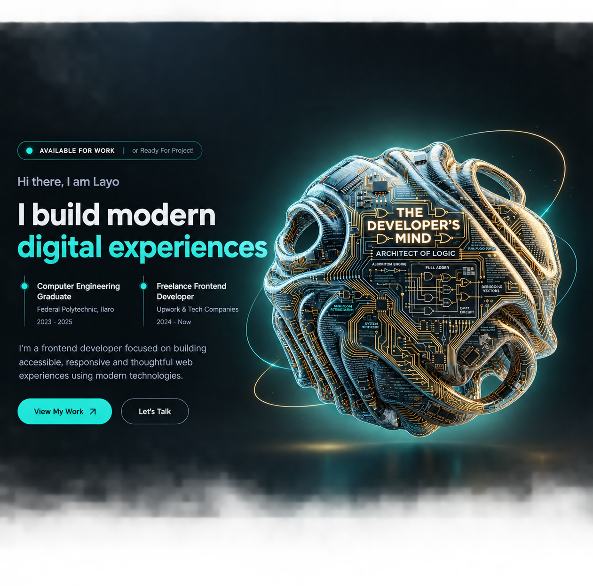

# Modern Developer Portfolio

A modern, responsive developer portfolio built with React, Vite, JavaScript, and CSS. This portfolio showcases my projects, technical skills, achievements, and contact information through a clean and interactive user interface.

### Live Demo: https://layodev.netlify.app/

### Developer: LayoDev

## Table of Contents

- [Modern Developer Portfolio](#modern-developer-portfolio)
  - [Live Demo: https://layodev.netlify.app/](#live-demo-httpslayodevnetlifyapp)
  - [Developer: LayoDev](#developer-layodev)
  - [Table of Contents](#table-of-contents)
  - [Overview](#overview)
  - [Features](#features)
  - [Tech Stack](#tech-stack)
  - [Portfolio Sections](#portfolio-sections)
    - [1. Hero](#1-hero)
    - [2. Projects](#2-projects)
    - [3. Achievements / About](#3-achievements--about)
    - [4. Skills](#4-skills)
    - [5. Contact](#5-contact)
    - [6. Footer](#6-footer)
  - [Featured Projects](#featured-projects)
  - [Project Structure](#project-structure)
    - [Folder Responsibilities](#folder-responsibilities)
    - [Hero section](#hero-section)
  - [Getting Started](#getting-started)
    - [Prerequisites](#prerequisites)
    - [Installation](#installation)
  - [Available Scripts](#available-scripts)
  - [Customization](#customization)
    - [Updating Projects](#updating-projects)
    - [Updating Skills](#updating-skills)
    - [Changing Colors and Themes](#changing-colors-and-themes)
    - [Updating Navigation](#updating-navigation)
    - [Updating Contact and Social Links](#updating-contact-and-social-links)
  - [Responsive Design](#responsive-design)
  - [Deployment](#deployment)
    - [Production Build](#production-build)
    - [Deployment Steps](#deployment-steps)
  - [Future Improvements](#future-improvements)
  - [Contact](#contact)
  - [Built by LayoDev](#built-by-layodev)

## Overview

This project is a personal portfolio website designed to present my work, demonstrate my frontend development skills, and provide an easy way for visitors to learn more about me.

The website features a modern design with teal and blue gradient accents, smooth transitions, responsive layouts, and support for both dark and light themes.

It is built with reusable React components and an organized folder structure to make the code easier to maintain, understand, and extend.

## Features

- **Responsive Design:** Adapts to desktop, tablet, and mobile screen sizes.
- **Dark and Light Themes:** Allows visitors to switch between different visual themes.
- **Sticky Navigation:** Keeps the navigation bar accessible while scrolling.
- **Mobile Navigation:** Includes a collapsible menu for smaller screens.
- **Hero Section:** Introduces me and highlights my focus as a developer.
- **Projects Showcase:** Displays selected projects with preview images, descriptions, and links.
- **Skills Section:** Presents my technical skills in organized categories.
- **Achievements Section:** Highlights relevant accomplishments and professional development.
- **Contact Section:** Provides a convenient way for visitors to reach me.
- **Interactive UI:** Uses subtle transitions, hover effects, and gradient accents.
- **Reusable Components:** Keeps the code modular and maintainable.
- **Custom Styling:** Uses shared CSS variables for consistent colors, typography, spacing, and transitions.
- **Footer Navigation:** Provides additional navigation links, social links, and a back-to-top action.

## Tech Stack

The project is built with the following technologies:

- **React** — For building reusable and interactive UI components.
- **Vite** — For fast development and optimized production builds.
- **JavaScript (ES6+)** — For application logic and interactivity.
- **JSX** — For writing UI components.
- **CSS3** — For layouts, animations, responsive design, and theme styling.
- **Lucide React** — For interface icons.

## Portfolio Sections

### 1. Hero

The hero section introduces me with a headline, supporting text, calls to action, and a visual element that establishes the portfolio's identity.

### 2. Projects

The projects section showcases selected work through project cards, preview images, technology details, and links to live demonstrations or source code where available.

### 3. Achievements / About

This section provides space to highlight accomplishments, experience, and relevant aspects of my development journey.

### 4. Skills

The skills section organizes my technical strengths into categories such as frontend development, JavaScript, and tools and workflow.

### 5. Contact

The contact section encourages collaboration and gives visitors a way to get in touch.

### 6. Footer

The footer includes additional navigation, social links, and a back-to-top option.

## Featured Projects

The portfolio showcases a selection of frontend projects, including:

- **FluxCampus** — A frontend project developed during an internship with Flux Creative Technologies.
- **FlowBank** — A banking interface concept focused on presenting financial information through a modern UI.
- **Luxury Barber** — A website concept for a professional barbering business.
- **Shopping Calculator** — An interactive application for shopping calculations.
- **Mapty** — A workout-mapping application.
- **Forkify** — A recipe-search application.

Each project include a description, technologies used, preview images, and links to its live version or source code.

## Project Structure

The project is organized into reusable components, page sections, data modules, assets, and shared styles.

```text
modern-portfolio/
├── public/
│   └── images/
│       └── developer'sMind.png
├──src/
├── assets/
│   └── images/
│       └── projects/
├── components/
│   ├── Footer/
│   ├── Navbar/
│   └── ThemeToggle/
├── data/
│   ├── projects.js
│   └── skills.js
├── pages/
│   └── Home/
├── sections/
│   ├── Achievements/
│   ├── Contact/
│   ├── Hero/
│   ├── Projects/
│   └── Skills/
└── styles/
    ├── globals.css
    ├── responsive.css
    └── variables.css
```

### Folder Responsibilities

- **`components/`** — Contains reusable UI components such as the navbar, footer, and theme toggle.
- **`sections/`** — Contains the main sections displayed on the homepage.
- **`data/`** — Stores structured content, including project and skill information.
- **`assets/`** — Stores images and other static resources.
- **`pages/`** — Combines sections into complete pages.
- **`styles/`** — Contains global styles, responsive rules, and shared design variables.

---

### Hero section



- **Live Demo:** [View Live Project](https://layodev.netlify.app/)
- **Source Code:** [View on GitHub](https://github.com/Noftyfootie/modern-portfolio)

---

## Getting Started

Follow these instructions to run the project locally.

### Prerequisites

Make sure you have the following installed:

- [Node.js](https://nodejs.org/)
- npm, which is included with Node.js

You can verify your installation by running:

```bash
node --version
npm --version
```

### Installation

**1. Clone the repository**

```bash
git clone https://github.com/Noftyfootie/modern-portfolio
```

**2. Navigate to the project directory**

```bash
cd modern-portfolio
```

**3. Install dependencies**

```bash
npm install
```

**4. Start the development server**

```bash
npm run dev
```

**5. Open the application**

Open the local URL displayed in your terminal. Vite commonly uses:

```text
http://localhost:5173
```

## Available Scripts

The project uses Vite for development and production builds.

| Command           | Description                            |
| ----------------- | -------------------------------------- |
| `npm run dev`     | Starts the local development server.   |
| `npm run build`   | Creates an optimized production build. |
| `npm run preview` | Previews the production build locally. |

The available commands depend on the scripts configured in `package.json`.

## Customization

### Updating Projects

Project information can be maintained in the project's data module, such as `src/data/projects.js`, if that file is used by your current implementation.

Update project names, descriptions, technologies, preview images, and links as needed.

### Updating Skills

Edit `src/data/skills.js` to add, remove, or update skill categories and descriptions.

### Changing Colors and Themes

Use `src/styles/variables.css` to adjust shared design tokens, including:

- Accent colors and gradients
- Background colors
- Primary and secondary text colors
- Borders
- Typography
- Spacing
- Transitions

### Updating Navigation

When adding a new section:

1. Create the section component and its stylesheet.
2. Add the section to the homepage.
3. Assign the section a unique HTML `id`.
4. Add a navigation link pointing to that ID.
5. Test the link on desktop and mobile.
6. Check that sticky navigation does not cover the section heading.

### Updating Contact and Social Links

Make sure the contact information, social profiles, and project links point to the correct destinations before publishing the website.

## Responsive Design

The portfolio is designed to work across different screen sizes.

Responsive styling helps the layout adapt to smaller devices, while the mobile navigation provides access to the main sections without overcrowding the header.

The website should be tested on different viewport sizes to ensure that:

- Navigation links remain accessible.
- Project cards fit the available screen width.
- Text remains readable.
- Images scale correctly.
- Buttons and controls are easy to use.
- Both themes display correctly.
- Section navigation works as expected.

## Deployment

The portfolio can be deployed to a static hosting platform that supports Vite applications.

### Production Build

Run the following command:

```bash
npm run build
```

Vite generates the production-ready files in the `dist/` directory by default.

### Deployment Steps

1. Push the latest project changes to your Git repository.
2. Import the repository into your preferred hosting platform.
3. Configure the build command as `npm run build`.
4. Set the output directory to `dist`.
5. Deploy the application.
6. Test the deployed website on desktop and mobile.

After deployment, add your verified live website URL to this README.

## Future Improvements

Potential improvements include:

- Adding detailed case studies for selected projects.
- Providing more information about each project's development process.
- Improving SEO metadata and social sharing previews.
- Adding a custom favicon.
- Optimizing images and overall page performance.
- Improving accessibility and keyboard navigation.
- Adding automated code quality checks.
- Expanding the portfolio as new projects and skills are developed.

## Contact

Feel free to connect with me through the contact information and social links available on my portfolio website.

I am open to learning opportunities, collaboration, and projects that help me continue growing as a developer.

---

## Built by LayoDev

- With React,
- Vite,
- JavaScript,
- And CSS.
